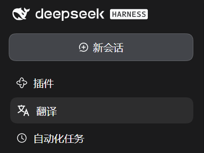
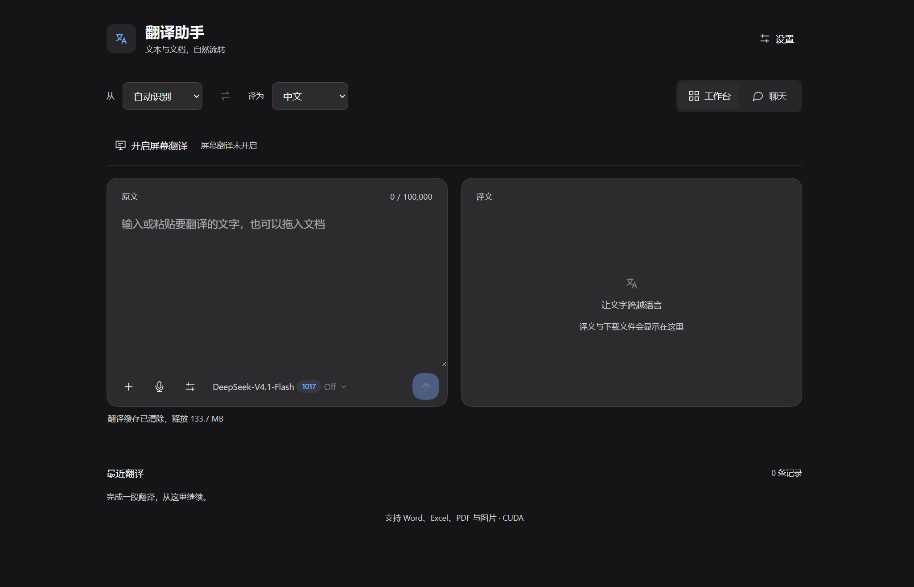

# 翻译助手 · CPU / SACC Translator CPU

在 DSH 侧栏点击“翻译”，打开独立的专属翻译界面。工作台提供原文与译文双栏，支持切换到聊天模式；文本翻译、文档上传、译文下载和最近翻译记录集中在同一页面。

- **专属入口与界面**：侧栏直达翻译助手，工作台／聊天模式按需切换。
- **文本与文档翻译**：支持 Word、Excel、PowerPoint、PDF、图片及常见文本格式，文档翻译尽量保留原格式。
- **复用 DSH 能力**：使用已配置的模型、模型选择、语音输入与文档预览。
- **屏幕框选翻译**：在面板开启后，按 Ctrl+Shift+S 框选、Enter 翻译；提供高斯模糊背景浮层。
- **历史与结果管理**：查看最近翻译，复制译文、下载文件、清理翻译缓存。

## 界面预览

侧栏中的独立“翻译”入口：

专属翻译工作台，包含语言选择、工作台／聊天切换、屏幕翻译和原文／译文双栏：

截图展示 CUDA 版；CPU 版使用相同界面，运行库不同。

## Dedicated translation interface

Open **Translation** from the DSH sidebar to enter a dedicated interface with **Workbench / Chat** modes, side-by-side source and translation, document uploads and downloads, recent translations, and screen-region translation. Uses the models configured in DSH, with host voice input and document preview. Document translation aims to preserve the original formatting.

## 安装与运行说明 / Installation and runtime

Windows x64. DSH version numbers are unrestricted (engines.dsh = *); required host APIs are checked at startup. Future API changes may still require updates.

This small npm package automatically installs its pinned document runtime from GitHub Releases. The CUDA edition also installs its pinned GPU component. No postinstall scripts are required. CPU/CUDA share settings and translation history; enable only one edition.

CPU downloads about 364 MB in total; CUDA about 2.04 GB including CUDA/cuDNN. A short versioned runtime directory under LOCALAPPDATA avoids Windows DLL path limits, using hard links where possible.

Source, installation details and validation: https://github.com/piaomiaozhilei/dsh-sacc-translator

Version 0.1.19 defaults to 5 concurrent translation requests; saved preferences take precedence. Bundle overrides support PDF/general file reads up to 1 GiB, Excel up to 256 MiB/1,000,000 cells/120 seconds, and Office inputs up to 512 MiB with PDF output up to 1 GiB and a 300-second conversion timeout. Large previews still load full files and need sufficient memory. Profile overrides take precedence.

Version 0.2.2 includes native Rust screen translation. Enable it in the translator panel, press Ctrl+Shift+S to select an area, then Enter to translate. Selection persists while translating; the overlay uses a continuous Gaussian-blurred backdrop. Screen OCR uses CPU in both editions and releases models after 45 seconds idle. Full live-desktop/model visual verification remains incomplete.
